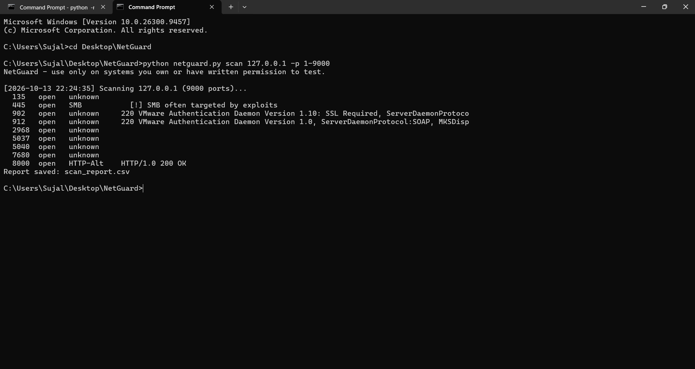
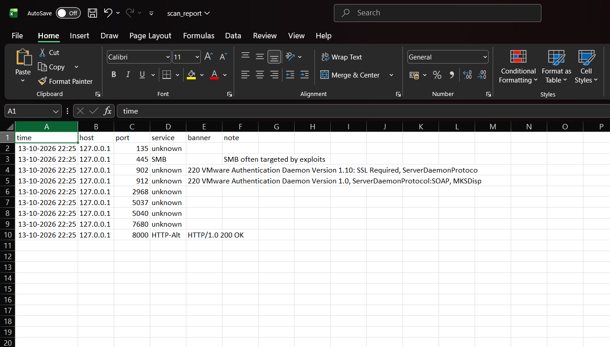

# NetGuard - Network Security Scanner & Intrusion Detection Tool

A Python tool that scans hosts for open ports and services, discovers live hosts in a subnet,
and monitors network traffic to detect port scans and SYN floods.

> **Legal notice:** Use only on systems you own or have written permission to test.

## Features
- TCP port scanner (multithreaded) with service identification and banner grabbing
- Flags risky exposed services (Telnet, FTP, SMB, RDP)
- Live host discovery for a subnet (e.g. 192.168.1.0/24)
- Packet sniffer (Scapy) detecting **port scans** and **SYN floods** with severity levels
- CSV reports with timestamps for scans and alerts

## Setup
```bash
pip install -r requirements.txt
```

## Usage
```bash
python netguard.py scan 192.168.1.10 -p 1-1024
python netguard.py discover 192.168.1.0/24
sudo python netguard.py sniff -i eth0 --duration 60
```

## Lab Testing
1. Kali Linux VM (attacker) + Metasploitable VM (target) on a host-only network.
2. Run `sniff` on the target/monitor machine.
3. Run `nmap -sS <target>` from Kali -> NetGuard raises a **Port Scan** alert.
4. Run `hping3 -S --flood <target>` -> NetGuard raises a **SYN Flood** alert.
5. Compare results with Wireshark captures and Nmap output.

## Tech
Python 3, socket, threading, Scapy, CSV | Tested on Kali Linux

## Results


## Future Improvements
Email alerts, UDP scanning, GeoIP lookup of attackers, web dashboard.
